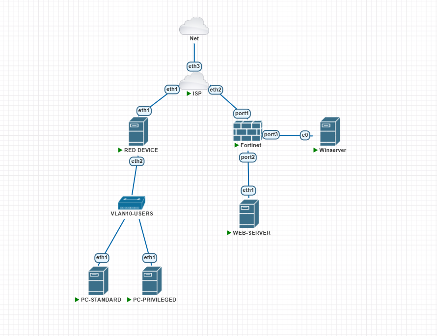

# DMZ y Jump Server — INFRA2

[🎥 Video demostrativo del laboratorio](https://1drv.ms/f/c/6b63aaec5c0ec7fc/IgDdeSxuWd94R5C7nNdUCZQvATgOQLWWoG6D2exazDmtuqs?e=XxxQHa)

Práctica académica de segmentación de red, VPN site-to-site, servidor de salto y RemoteApp, implementada en PNETLab con FortiGate.

[Galería de evidencias](docs/evidencias.md) · [Procedimiento de validación](docs/validacion.md) · [Inventario de scripts](scripts/README.md) · [Archivo de topología PNETLab](<lab/DMZ y Jump Server INFRA2.unl>) · [Running-configs](running-configs/README.md)

## Propósito del laboratorio

Demostrar una arquitectura segmentada para publicar aplicaciones RemoteApp y permitir que usuarios estándar y privilegiados accedan a un Jump Server según sus permisos. El tráfico hacia el Web Server debe pasar por el Jump Server; el acceso directo desde la VLAN de usuarios se deniega. El laboratorio también verifica un túnel VPN site-to-site y documenta las reglas de acceso con evidencias reproducibles.

## Topología del laboratorio

La imagen es una captura original de la topología de PNETLab proporcionada para esta práctica.

## Componentes y direccionamiento

| Segmento | Interfaz / equipo | Dirección | Función |
|---|---|---:|---|
| VLAN 10 Users | RED DEVICE / DHCP | `10.17.45.1/25` | Gateway y DHCP de clientes |
| VLAN 10 Users | PC-STANDARD | `10.17.45.10/25` | Usuario estándar |
| VLAN 10 Users | PC-PRIVILEGED | `10.17.45.11/25` | Usuario privilegiado |
| Web LAN | FortiGate port2 | `10.17.45.129/29` | Gateway del Web Server |
| Web LAN | WEB-SERVER | `10.17.45.130/29` | Servicios HTTPS, RDP y SSH |
| Jump LAN | FortiGate port3 | `10.17.45.137/29` | Gateway del Jump Server |
| Jump LAN | WIN-1S9GHPAT5RF | `10.17.45.138/29` | Jump Server, dominio `infra2.lab` |
| WAN de laboratorio | FortiGate port1 | `198.51.100.46/30` | Interfaz WAN simulada |
| VPN site-to-site | Peer remoto | `203.0.113.17` | Gateway remoto configurado |

Las direcciones WAN pertenecen a los bloques TEST-NET-2 y TEST-NET-3, reservados para documentación. En esta topología son valores de laboratorio y no direcciones públicas reales para enrutar por Internet ([RFC 5737](https://www.rfc-editor.org/rfc/rfc5737.html)).

## Segmentación y acceso

| Origen | Destino | Servicios | Resultado esperado |
|---|---|---|---|
| PC-STANDARD | Jump Server | HTTPS | Permitido |
| PC-STANDARD | Jump Server | SSH | Denegado |
| PC-PRIVILEGED | Jump Server | HTTPS, RDP y SSH | Permitido según política |
| VLAN 10 | Web Server directo | Cualquier servicio | Denegado |
| Jump Server | Web Server | HTTPS, RDP y SSH | Permitido |

La política `ALLOW_JUMP_TO_WEB_REQUIRED` conecta `INFRA2_JUMP_SERVER` con `INFRA2_WEB_SERVER` para HTTPS, RDP y SSH. Tiene NAT deshabilitado. El acceso de la VLAN 10 al Web Server se bloquea con `DENY_VLAN10_DIRECT_TO_WEB`.

## VPN site-to-site

El túnel FortiGate `INFRA2-S2S` aparecía **Up** en la captura. El selector Phase 2 limita la red local al Jump Server (`10.17.45.138/32`) y la red remota a VLAN 10 (`10.17.45.0/25`). La configuración y las políticas del FortiGate se documentan mediante capturas de su GUI, conforme al requisito de la práctica.

## Usuarios y RemoteApp

El dominio configurado es `infra2.lab`. La asignación documentada para la colección `QuickSessionCollection` es:

| Cuenta | Grupos | Aplicaciones RemoteApp esperadas |
|---|---|---|
| `standard` | `RDS-WEB` | Microsoft Edge |
| `privileged` | `RDS-WEB`, `RDS-PRIVILEGED` | Microsoft Edge, PuTTY y Conexión a Escritorio remoto |

La cuenta privilegiada pertenece a `RDS-WEB` para compartir Edge y a `RDS-PRIVILEGED` para acceder a PuTTY y RDP. La cuenta estándar no debe pertenecer a `RDS-PRIVILEGED`.

## Comprobaciones realizadas

- PC-STANDARD obtuvo por DHCP `10.17.45.10/25`; PC-PRIVILEGED obtuvo `10.17.45.11/25`.
- HTTPS de ambos clientes al Jump Server respondió `HTTP 200`.
- SSH de PC-STANDARD al Jump Server fue rechazado.
- Las pruebas directas desde clientes al Web Server agotaron el tiempo de espera.
- Desde PC-PRIVILEGED se alcanzó el puerto RDP del Jump Server (`10.17.45.138:3389`).
- Desde el Jump Server se comprobó conectividad TCP al Web Server en los puertos 443, 3389 y 22.
- La galería contiene capturas originales de DHCP, pruebas de acceso, VPN, selectores Phase 2, políticas y tráfico del FortiGate.

## Observaciones y límites

- Al iniciar aplicaciones RemoteApp aparece una advertencia porque el certificado de la puerta de enlace `WIN-1S9GHPAT5RF.infra2.lab` no es reconocido por el cliente. La identidad del servidor debe comprobarse antes de aceptar el aviso en la demostración.
- La captura de políticas del FortiGate muestra que el reloj del equipo estaba fuera de sincronización; los timestamps del registro pueden no coincidir con la hora del cliente.
- La configuración del túnel está identificada como evaluación de laboratorio de baja encriptación. No se debe reutilizar en producción.
- Las capturas disponibles prueban la conectividad con los puertos del Web Server, pero no incluyen una imagen de la interfaz del Sistema de Caja. Su presentación debe validarse en el video o añadirse como evidencia visual.
- No se incluyen contraseñas, claves precompartidas ni credenciales en el repositorio.

## Evidencias

Consulta [docs/evidencias.md](docs/evidencias.md) para las capturas originales organizadas por función.

## Topología y configuraciones

El archivo [DMZ y Jump Server INFRA2.unl](<lab/DMZ y Jump Server INFRA2.unl>) permite importar la topología en PNETLab. Las configuraciones capturadas desde el laboratorio activo, el alcance de cada archivo y los secretos redactados están descritos en [running-configs](running-configs/README.md).

La topología referencia imágenes de PNETLab para FortiGate y Windows Server, además de las imágenes personalizadas `pnetlab/infra2-web-rdp:1745`, `pnetlab/infra2-red-router:1745` y `pnetlab/infra2-chrome-client:1745`. El archivo `.unl` no incluye esas imágenes binarias; deben existir en el host PNETLab para iniciar todos los nodos.
