# Evidencias de la práctica

Las imágenes de esta carpeta son capturas originales realizadas durante la comprobación del laboratorio. No se generaron diagramas ni se alteró el contenido de las capturas.

## Topología

## DHCP y acceso de clientes

| Comprobación | Evidencia |
|---|---|
| Lease DHCP PC-STANDARD: `10.17.45.10/25`, gateway `10.17.45.1` | 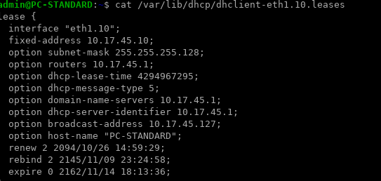 |
| Lease DHCP PC-PRIVILEGED: `10.17.45.11/25`, gateway `10.17.45.1` | 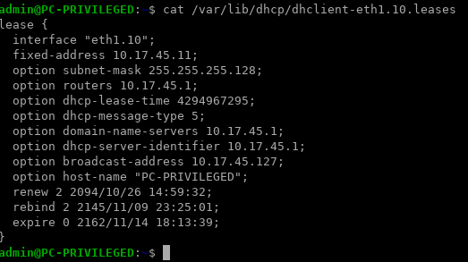 |
| PC-STANDARD → Jump por HTTPS: `HTTP 200` | 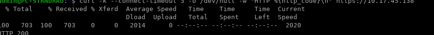 |
| PC-STANDARD → Jump por SSH: conexión rechazada | 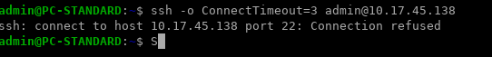 |
| PC-PRIVILEGED → Jump por HTTPS: `HTTP 200` | 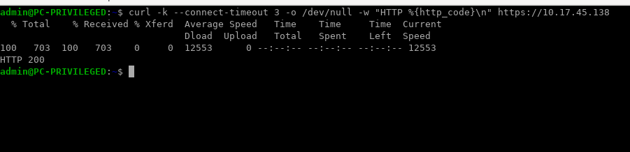 |
| PC-PRIVILEGED → Jump por RDP: TCP 3389 conectado | 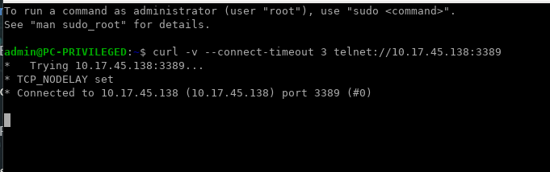 |
| PC-PRIVILEGED → Web directo: timeout | 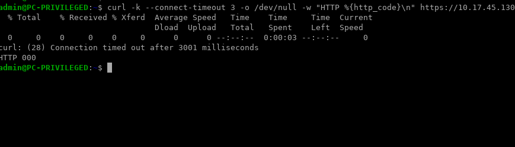 |

## VPN y reglas del FortiGate

| Comprobación | Evidencia |
|---|---|
| Túnel `INFRA2-S2S` en estado Up | 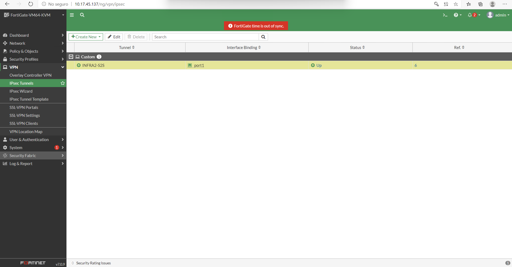 |
| Selector Phase 2: Jump `/32` y VLAN 10 `/25` | 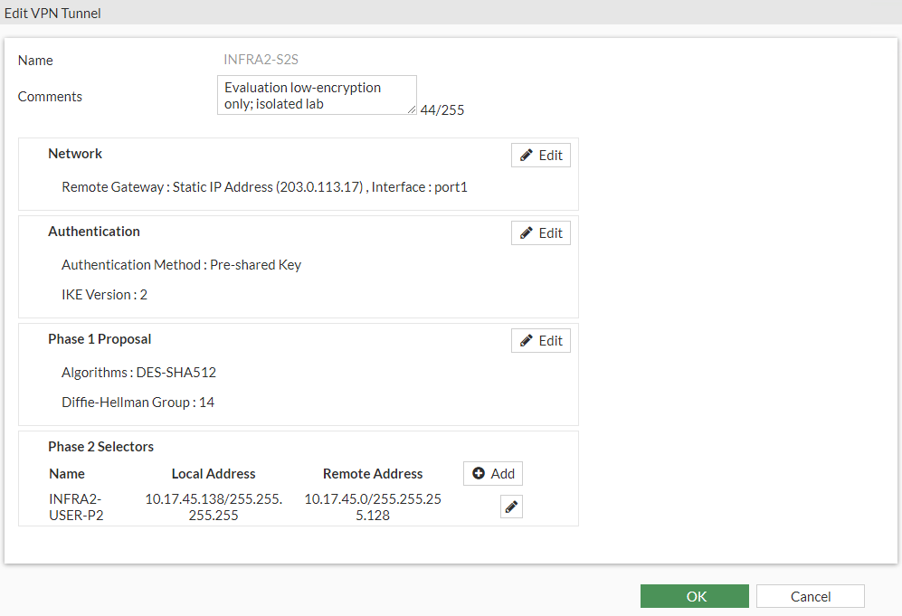 |
| Políticas de firewall para usuarios, servidores y salida | 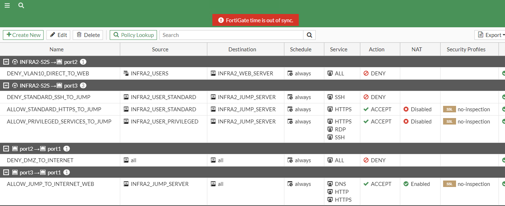 |
| Regla Jump → Web: HTTPS, RDP y SSH; ACCEPT; NAT deshabilitado | 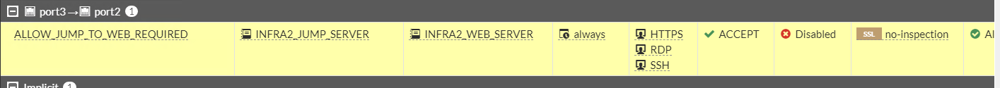 |
| Registro de tráfico del FortiGate | 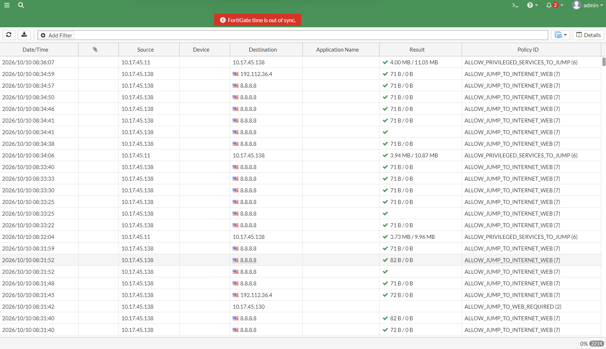 |

## Jump Server → Web Server

| Puerto | Servicio | Resultado |
|---:|---|---|
| 443 | HTTPS | TCP accesible |
| 3389 | RDP | TCP accesible |
| 22 | SSH | TCP accesible |

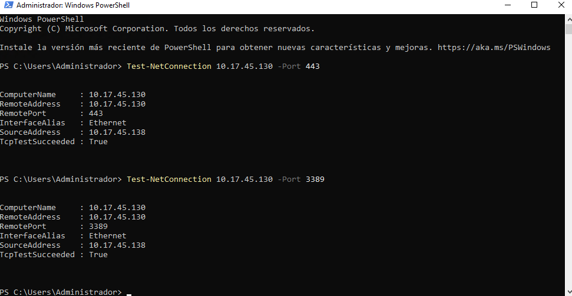

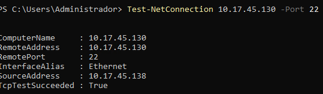

## RemoteApp

Al iniciar RemoteApp se mostró una advertencia de confianza del certificado de la puerta de enlace. Esta captura documenta el aviso observado durante la práctica.

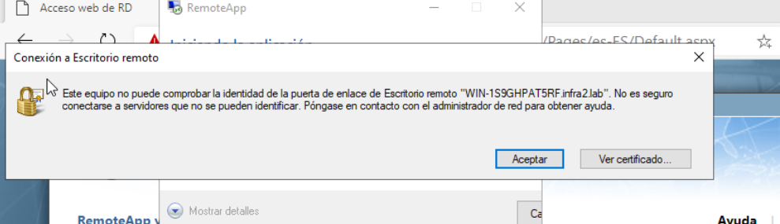

La configuración final de los grupos y de PuTTY/RDP se confirmó en la consola del servidor durante la sesión de práctica. No se conserva una captura posterior de esa lista en el conjunto de evidencias disponible.
